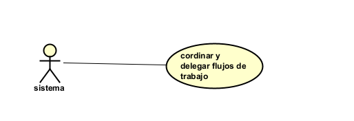
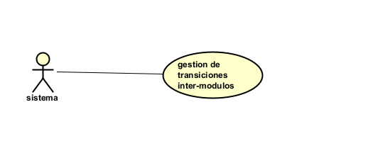
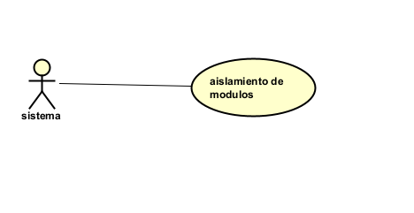
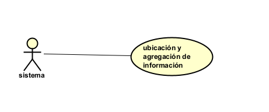
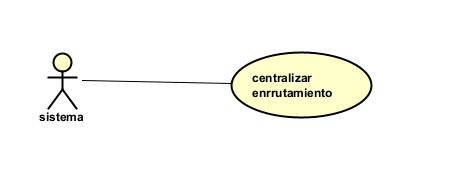

## 1. Lista general de requerimientos — Orchestrator

El componente **Orchestrator** de OFICIOYA centraliza y coordina los flujos de negocio complejos entre múltiples microservicios y servicios externos, cumpliendo con los siguientes requerimientos:

### 1.1 Requerimientos funcionales

El sistema de OFICIOYA (Orchestrator) debe tener la capacidad de:

1. El sistema debe coordinar y enlazar flujos de trabajo complejos delegando tareas específicas a múltiples módulos independientes (como Identidad, Usuarios y Notificaciones) sin ejecutar lógica de dominio de forma directa.

2. El sistema debe gestionar las transacciones inter-módulos, ejecutando acciones de compensación (rollbacks lógicos) para revertir operaciones previas si un paso del flujo falla, asegurando la consistencia global de los datos.

3. El sistema debe aislar los módulos de dominio entre sí, garantizando que un servicio local (como UserService) no necesite inyectar ni comunicarse directamente con otros servicios paralelos (como NotificationService o CredentialService).

4. El sistema debe unificar y estructurar la información, agregando los datos provenientes de distintos servicios internos en un único objeto de respuesta estructurado antes de enviarlo a la capa de presentación.

5. El sistema debe centralizar el enrutamiento hacia herramientas o plataformas de terceros (como Firebase o la API de Gemini), invocándolas en el paso exacto del flujo de negocio y distribuyendo sus respuestas hacia los servicios internos correspondientes.

## 2. Diagramas y tablas de casos de uso — Orchestrator

### 2.1 Requerimiento Funcional OR-01

| Campo | Descripción |
|------|-------------|
| **ID** | RF-OR-01 |
| **Nombre del requerimiento** | Coordinación y delegación de flujos de trabajo complejos |
| **Descripción** | El sistema debe coordinar y enlazar flujos de trabajo complejos delegando tareas específicas a múltiples módulos independientes (como Identidad, Usuarios y Notificaciones) sin ejecutar lógica de dominio de forma directa. |
| **Precondiciones** | 1. Los módulos o servicios de dominio involucrados (Identidad, Usuarios, Notificaciones, etc.) se encuentran activos y disponibles en la red interna. 2. El cliente emite una solicitud con los parámetros necesarios para desencadenar el flujo orquestado. |
| **Actor** | Sistema |
| **Flujo principal** | 1. El Orchestrator recibe la petición de un flujo compuesto (ej. registro completo de usuario). 2. El Orchestrator determina la secuencia lógica de delegaciones requerida sin ejecutar lógica de negocio propia. 3. El sistema invoca al módulo de Identidad para la creación de credenciales. 4. Recibida la respuesta exitosa, el sistema delega la creación del perfil al módulo de Usuarios. 5. El sistema delega el envío de confirmación al módulo de Notificaciones. 6. El Orchestrator consolida el estado final y responde al cliente. |
| **Diagrama de caso de uso** |  |
| **Postcondiciones** | El flujo de trabajo complejo finaliza exitosamente con las responsabilidades delegadas a los módulos pertinentes sin acoplar lógica de dominio en el Orchestrator. |

### 2.2 Requerimiento Funcional OR-02

| Campo | Descripción |
|------|-------------|
| **ID** | RF-OR-02 |
| **Nombre del requerimiento** | Gestión de transacciones inter-módulos y compensación (Rollbacks lógicos) |
| **Descripción** | El sistema debe gestionar las transacciones inter-módulos, ejecutando acciones de compensación (rollbacks lógicos) para revertir operaciones previas si un paso del flujo falla, asegurando la consistencia global de los datos. |
| **Precondiciones** | 1. Se inicia un flujo transaccional distribuido que involucra múltiples módulos independientes. 2. Los módulos participantes exponen endpoints o mecanismos de compensación lógica (patrón Saga). |
| **Actor** | Sistema |
| **Flujo principal** | 1. El Orchestrator ejecuta secuencialmente los pasos del flujo transaccional distribuido. 2. Se ejecuta con éxito la operación en el primer módulo (ej. persistencia inicial de usuario). 3. El Orchestrator ejecuta el siguiente paso en otro módulo (ej. asignación de rol o credencial). 4. El segundo módulo genera un fallo (error de negocio, timeout o indisponibilidad). 5. El Orchestrator detecta la falla e inicia la fase de compensación en orden inverso. 6. El Orchestrator invoca la acción de compensación (rollback lógico) en el primer módulo para revertir la operación previa. 7. El Orchestrator verifica que el estado quede consistente y retorna un error controlado al cliente. |
| **Diagrama de caso de uso** |  |
| **Postcondiciones** | Se preserva la consistencia global de los datos entre módulos mediante compensaciones automáticas, evitando datos inconsistentes o huérfanos. |

### 2.3 Requerimiento Funcional OR-03

| Campo | Descripción |
|------|-------------|
| **ID** | RF-OR-03 |
| **Nombre del requerimiento** | Aislamiento y desacoplamiento de módulos de dominio |
| **Descripción** | El sistema debe aislar los módulos de dominio entre sí, garantizando que un servicio local (como UserService) no necesite inyectar ni comunicarse directamente con otros servicios paralelos (como NotificationService o CredentialService). |
| **Precondiciones** | 1. Los servicios de dominio están diseñados como componentes autónomos e independientes. 2. La coordinación entre servicios se canaliza exclusivamente a través del Orchestrator. |
| **Actor** | Sistema |
| **Flujo principal** | 1. Se solicita una operación que requiere colaboración entre dominios (ej. cambio o restablecimiento de contraseña). 2. El cliente invoca el caso de uso a través del Orchestrator. 3. El servicio local (ej. `UserService`) ejecuta únicamente su lógica de dominio sin requerir referencias ni inyección de dependencias de `NotificationService` ni de `CredentialService`. 4. El servicio local retorna el resultado de su operación al Orchestrator. 5. El Orchestrator se encarga de llamar de forma aislada a los demás servicios paralelos involucrados según lo requiera el flujo. |
| **Diagrama de caso de uso** |  |
| **Postcondiciones** | Los módulos de dominio permanecen desacoplados, autónomos y libres de dependencias circulares o acoplamiento directo entre sí. |

### 2.4 Requerimiento Funcional OR-04

| Campo | Descripción |
|------|-------------|
| **ID** | RF-OR-04 |
| **Nombre del requerimiento** | Unificación y estructuración de información (Agregación de respuestas) |
| **Descripción** | El sistema debe unificar y estructurar la información, agregando los datos provenientes de distintos servicios internos en un único objeto de respuesta estructurado antes de enviarlo a la capa de presentación. |
| **Precondiciones** | 1. La interfaz de usuario o capa de presentación requiere datos compuestos provenientes de distintos servicios internos. 2. Los servicios internos de origen se encuentran disponibles y devuelven sus respectivos datos de dominio. |
| **Actor** |  Sistema |
| **Flujo principal** | 1. El cliente frontend emite una única solicitud HTTP para consultar una vista compuesta de información. 2. El Orchestrator despacha llamadas internas hacia los servicios de dominio que poseen la información. 3. El Orchestrator recibe las respuestas parciales devueltas por cada servicio. 4. El sistema unifica, filtra y estructura la información en un único DTO o modelo de respuesta consolidado. 5. El Orchestrator devuelve el objeto estructurado a la capa de presentación en una única respuesta HTTP. |
| **Diagrama de caso de uso** |  |
| **Postcondiciones** | La capa de presentación recibe un payload único y estructurado, reduciendo la latencia de red y simplificando el procesamiento en el frontend. |

### 2.5 Requerimiento Funcional OR-05

| Campo | Descripción |
|------|-------------|
| **ID** | RF-OR-05 |
| **Nombre del requerimiento** | Centralización del enrutamiento hacia plataformas de terceros |
| **Descripción** | El sistema debe centralizar el enrutamiento hacia herramientas o plataformas de terceros (como Firebase o la API de Gemini), invocándolas en el paso exacto del flujo de negocio y distribuyendo sus respuestas hacia los servicios internos correspondientes. |
| **Precondiciones** | 1. Las credenciales, claves de API y configuraciones de servicios externos (Firebase, Gemini API) están gestionadas centralizadamente en el Orchestrator. 2. El flujo de negocio en curso requiere la integración o procesamiento con un servicio externo. |
| **Actor** | Sistema / Plataformas de terceros (Firebase, API de Gemini) |
| **Flujo principal** | 1. El Orchestrator ejecuta un flujo de negocio y llega al paso en el que se requiere la intervención de una plataforma externa. 2. El Orchestrator construye y envía la solicitud hacia la API de la herramienta externa (ej. almacenamiento en Firebase o generación inteligente con Gemini). 3. El proveedor externo procesa la petición y retorna su respuesta al Orchestrator. 4. El Orchestrator procesa la respuesta externa y extrae los datos resultantes. 5. El Orchestrator distribuye y reenvía dichos datos hacia los servicios internos pertinentes para continuar el procesamiento de negocio o persistencia. |
| **Diagrama de caso de uso** |  |
| **Postcondiciones** | La integración con plataformas externas se mantiene centralizada y protegida, entregando los resultados a los servicios internos sin que estos gestionen dependencias con terceros. |

